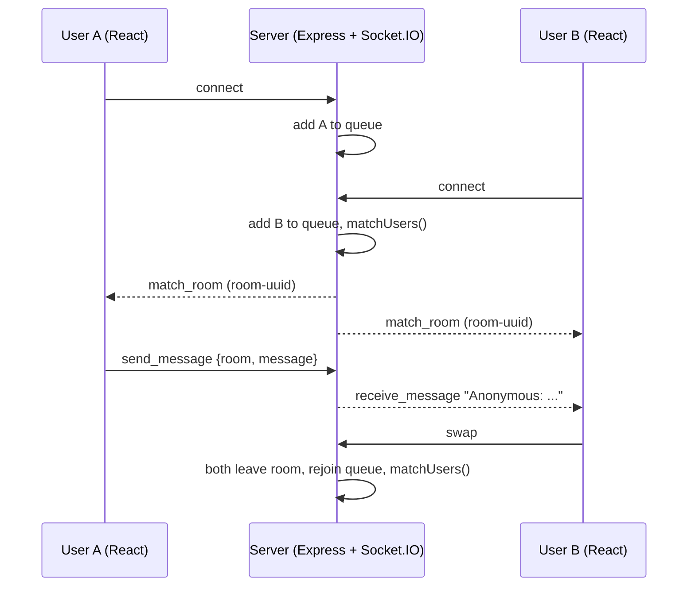

# TexChange

An anonymous text chat roulette. Open the site, get paired with a random stranger, and swap to someone new whenever you like.


## Demo

<!-- TODO: demo link or video -->

## Overview

TexChange works like Omegle but text only. Each visitor who opens the chat page joins a waiting queue. As soon as two people are waiting, the server puts them in a private room and relays messages between them with no names attached. Either person can ask for a new partner at any time, and if one leaves, the other goes back into the queue automatically.

## Key features

- Automatic matchmaking: users are paired as soon as two are waiting.
- Anonymous one-to-one messaging. The sender sees "You:" and the recipient sees "Anonymous:".
- A Swap button that sends both people back to the queue to find new partners.
- Partner-left handling: the remaining user is told and re-queued without reloading.
- A loading screen while the server looks for a match.
- Docker Compose setup that runs the frontend and backend together.

## Tech stack

| Area | Tools |
|---|---|
| Frontend | React 19, React Router 7 (`HashRouter`), Create React App |
| Realtime | Socket.IO 4 (client and server) |
| Backend | Node.js, Express 4, `uuid` |
| Infrastructure | Docker, Docker Compose |

## Architecture

The React app has two routes: `/` (landing page) and `/chat`. Opening `/chat` connects a Socket.IO client to the Express server on port 5001. The server holds all matchmaking state in memory: a `Set` of waiting sockets and a map from socket ID to room.



## Technical highlights

- The waiting queue is a `Set` of sockets, so a user can't be queued twice, and removing someone on disconnect is a single `delete` with no array search. `matchUsers()` takes the first two entries in insertion order, so the people who have waited longest are matched first.
- Each room gets a UUID name. Messages go only to the other socket in the room, not back to the sender, so the client adds its own "You:" line locally.
- On disconnect the server tells the remaining partner, removes both room entries and puts the partner back in the queue in the same handler, so nobody is left in a dead room.
- The app first ran on Flask with gunicorn and eventlet, and was later rewritten on Express and Socket.IO.

## Getting started

With Docker:

```sh
docker compose up --build
```

Then open http://localhost:3000 in two browser windows and click START CHATTING in each.

Without Docker (Node 18 or later), in two terminals:

```sh
# terminal 1
cd backend
npm install
FRONTEND_URL=http://localhost:5000 node server.js   # port 5001

# terminal 2
cd frontend
npm install
npm start               # http://localhost:5000 (PORT in frontend/.env)
```

The client connects to `http://localhost:5001`, which is hard-coded in `frontend/src/chat.js`. The server reads `PORT` and `FRONTEND_URL` from the environment (it doesn't load `backend/.env`), and only accepts Socket.IO connections from `FRONTEND_URL`, which defaults to `http://localhost:3000`. That default fits the Docker setup, where `.env` files are excluded from the images and the frontend runs on 3000.

## Team

Built by Haashir Khan, Moses Luna and Aviraj Ghatora.
