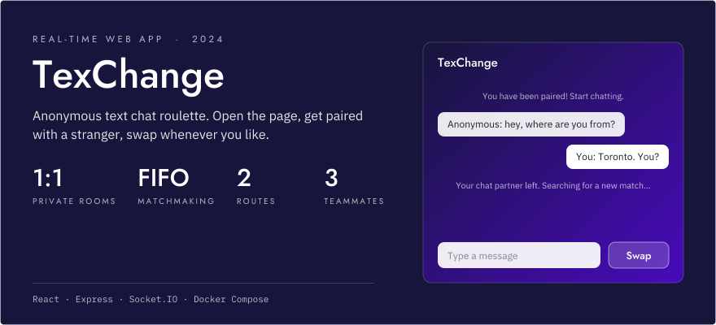
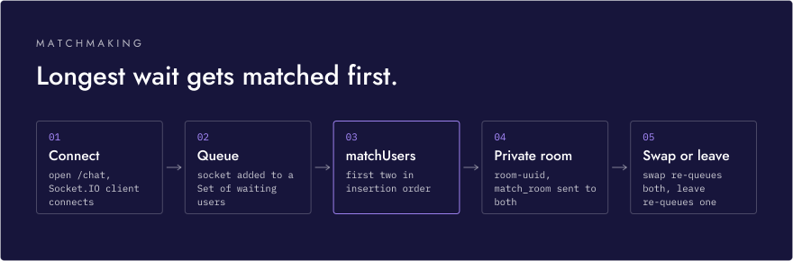
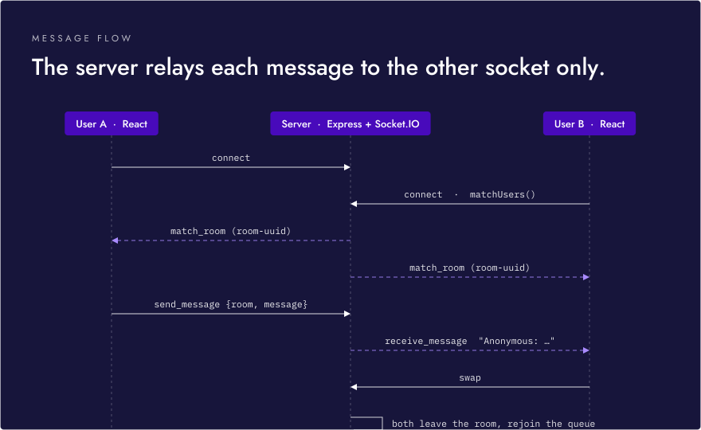
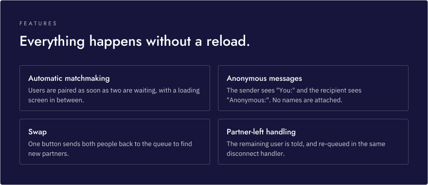

<p align="center">
  <picture>
    <source media="(prefers-color-scheme: dark)" srcset="assets/readme/hero-dark.svg">
    <source media="(prefers-color-scheme: light)" srcset="assets/readme/hero-light.svg">
    
  </picture>
</p>

<p align="center">
  <strong>Open the page, get paired with a stranger, and swap to someone new whenever you like.</strong><br>
  <strong>Private 1:1 rooms &middot; FIFO matchmaking &middot; no reloads</strong><br>
  <sub>React and Socket.IO on the client, Express and Socket.IO on the server, Docker Compose to run both.</sub>
</p>

<p align="center">
  
  
  
  
</p>

<!-- TODO: demo link or video -->

---

TexChange works like Omegle, but text only. Each visitor who opens the chat page joins a waiting queue. As soon as two people are waiting, the server puts them in a private room and relays messages between them with no names attached.

## Matchmaking

<p align="center">
  <picture>
    <source media="(prefers-color-scheme: dark)" srcset="assets/readme/matchmaking-dark.svg">
    <source media="(prefers-color-scheme: light)" srcset="assets/readme/matchmaking-light.svg">
    
  </picture>
</p>

The React app has two routes, `/` (the landing page) and `/chat`. Opening `/chat` connects a Socket.IO client to the Express server on port 5001. The server keeps all matchmaking state in memory: a `Set` of waiting sockets and a map from socket ID to room.

Because the queue is a `Set`, a user can't be queued twice, and removing someone on disconnect is a single `delete` with no array search. `matchUsers()` takes the first two entries in insertion order, so the people who have waited longest are matched first.

## Message flow

<p align="center">
  <picture>
    <source media="(prefers-color-scheme: dark)" srcset="assets/readme/message-flow-dark.svg">
    <source media="(prefers-color-scheme: light)" srcset="assets/readme/message-flow-light.svg">
    
  </picture>
</p>

Each room gets a UUID name. Messages go only to the other socket in the room, not back to the sender, so the client adds its own "You:" line locally. On disconnect, the server tells the remaining partner, removes both room entries and puts the partner back in the queue in the same handler, so nobody is left in a dead room.

The app first ran on Flask with gunicorn and eventlet, and was later rewritten on Express and Socket.IO.

## Features

<p align="center">
  <picture>
    <source media="(prefers-color-scheme: dark)" srcset="assets/readme/features-dark.svg">
    <source media="(prefers-color-scheme: light)" srcset="assets/readme/features-light.svg">
    
  </picture>
</p>

## Getting started

With Docker:

```sh
docker compose up --build
```

Then open http://localhost:3000 in two browser windows and click START CHATTING in each.

Without Docker (Node 18 or later), in two terminals:

```sh
# terminal 1
cd backend
npm install
FRONTEND_URL=http://localhost:5000 node server.js   # port 5001

# terminal 2
cd frontend
npm install
npm start               # http://localhost:5000 (PORT in frontend/.env)
```

The client connects to `http://localhost:5001`, which is hard-coded in `frontend/src/chat.js`. The server reads `PORT` and `FRONTEND_URL` from the environment (it doesn't load `backend/.env`), and only accepts Socket.IO connections from `FRONTEND_URL`, which defaults to `http://localhost:3000`. That default fits the Docker setup, where `.env` files are excluded from the images and the frontend runs on 3000.

## Team

Built by Haashir Khan, Moses Luna and Aviraj Ghatora.
